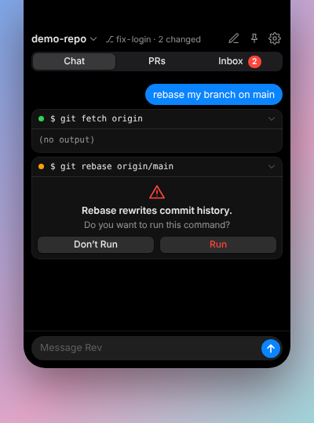
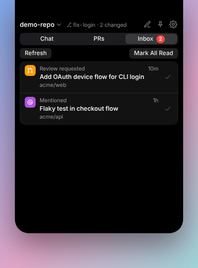
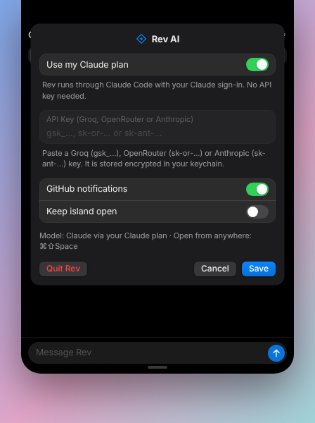

<p align="center"></p>

<h1 align="center">Rev AI</h1>

<p align="center">A Dynamic Island for your Mac that runs git and GitHub from plain English.<br>
Push, pull, rebase, branch, commit and manage pull requests by asking, with an approval step before anything risky.<br>
Also runs on <a href="#windows-and-linux">Windows and Linux</a>.</p>

<p align="center">
  
  
  
</p>

## Highlights

- **Lives around the notch.** Rev sits at the top center of the screen as a small black island. Click it or press ⌘⇧Space and it opens into the full app; click away and it shrinks back.
- **Git by prompt.** "Commit my changes with a good message and push", "rebase on main", "why did my push get rejected?". Every command Rev runs appears as a card with its output.
- **Safe by default.** A rule engine (`src/risk.js`) sorts every git and gh command. Force pushes, rebases, hard resets and merges stop for **Approve / Deny**; things like `gh auth` or secret changes are never allowed.
- **Pull requests and notifications.** A PR tab with review state, checks and conflicts for your repo's PRs, your PRs and ones waiting on your review, with checkout, merge and new PR (Merge only shows when you have permission), plus a GitHub inbox that peeks out of the island when something new arrives.
- **Bring your own AI.** Uses your Claude plan through Claude Code with no API key, or a Groq, OpenRouter or Anthropic key stored in your OS's secret store (macOS keychain, Windows DPAPI, or libsecret on Linux).
- **Make it yours.** Drag to resize, and change size, text, corners and colour from a few CSS variables.

**Companion widget:** [Rev Widget](https://github.com/samchinmaya/rev-ai-widget) puts your PRs and GitHub notifications in Notification Center and on the desktop.

**Built with** Electron, plain JavaScript (no build step), the Anthropic SDK tool runner, a small local MCP server for Claude Code, the GitHub CLI, and Node's built-in test runner.

## Setup

You need Node 20+, git, and the GitHub CLI (`gh`):

| OS | Install gh |
| --- | --- |
| macOS | `brew install gh` |
| Windows | `winget install --id GitHub.cli` (and Git: `winget install --id Git.Git`) |
| Debian / Ubuntu | `sudo apt install gh` (or the repo at cli.github.com for newer versions) |
| Fedora / RHEL | `sudo dnf install gh` |
| Arch | `sudo pacman -S github-cli` |

```sh
gh auth login        # Rev uses your gh sign-in for everything GitHub
git clone https://github.com/samchinmaya/rev-ai.git
cd rev-ai
npm install
npm start
```

**Easiest: use your Claude plan.** If Claude Code is installed and signed in (`claude` in a terminal, then sign in with your Claude account), Rev uses it automatically, with no API key. Rev runs `claude -p` with no built-in tools. Its only tools are Rev's `git` and `gh`, served from a small local MCP server inside Rev, so risky commands still wait for your Approve. Usage counts against your Claude plan. Turn it off in Settings (⚙) → "Use my Claude plan" to use an API key instead.

Otherwise, open Settings (⚙) and paste an API key. It is stored encrypted with your OS's secret store (macOS keychain, Windows DPAPI, or GNOME Keyring / KWallet through libsecret on Linux), never as plain text. On Linux without a keyring Rev refuses to save the key; use an environment variable instead.

- A **Groq** key (`gsk_…`) makes Rev use Groq's OpenAI-compatible API with a strong tool-calling model it offers (`openai/gpt-oss-120b` when available; override with `REV_GROQ_MODEL`).
- An **OpenRouter** key (`sk-or-…`) makes Rev call Claude through OpenRouter's Anthropic-compatible API. It picks the newest Claude Opus that OpenRouter lists (override with `REV_OPENROUTER_MODEL`).
- An **Anthropic** key (`sk-ant-…`) calls the Claude API directly with `claude-opus-5-5`.
- With no saved key, `GROQ_API_KEY`, `OPENROUTER_API_KEY` or `ANTHROPIC_API_KEY` from the environment is used.

To build a standalone app: `npm run dist` on a Mac (creates a .dmg in `dist/`). See [Windows and Linux](#windows-and-linux) for the other platforms.

## Using it

- Rev lives at the top center of your screen as a small black **island** around the notch. Click it (or press **⌘⇧Space**) and it morphs open into the full app; click anywhere else and it shrinks back. Pin 📌 keeps it open.
- When new GitHub notifications arrive, the island peeks out with the newest one; click it to open on GitHub. While the assistant works, the island shows a spinner, and an orange "Approve" when a command is waiting for you.
- The ◇ menu bar icon shows your unread GitHub count; right-click it for options and Quit.
- Click the repo chip to pick a repository (recent ones are remembered). Switching repos starts a fresh conversation.

### Changing the size and look yourself

- **Drag to resize:** open the island and drag the small bar at its bottom. Up/down changes the height, left/right the width. Rev remembers the size. Double-click the bar (or right-click ◇ → Reset Size) to go back to 340×470.
- **Edit the design by hand:** open `src/renderer/styles.css` and find the block marked **★ Design knobs**. Change `--app-width`, `--app-height`, `--text-size`, `--corner` or `--accent`, then quit Rev (right-click ◇ → Quit) and run `npm start` again. A size you dragged is saved in settings and wins over `--app-width`/`--app-height`; use Reset Size first if you want the CSS values. The default size used by Reset Size is `DEFAULT_SIZE` in `src/main.js`.

### The logo

Rev uses one logo everywhere: the island pill, the welcome screen, Settings, the menu bar, desktop notifications and the app icon.

- `assets/logo.svg` is the blue mark, and `assets/logo-mark.svg` is the same mark in `currentColor` for use on any background.
- `assets/app-icon.svg` is the rounded macOS app icon.
- `assets/*.png` are ready-made sizes (app icon 16 to 1024 px, logo 64 to 512 px). Other apps, like a widget, can reuse them.

To change the logo, edit the SVGs and run `npm run icons`. That redraws every PNG, `src/assets/icon.png` (used for notifications) and `build/icon.icns` (used by `npm run dist`). The menu bar icon is `src/assets/trayTemplate.png`.

### Assistant tab

Type what you want: "pull the latest", "commit my changes with a good message and push", "create a branch called fix/login from main", "rebase on main", "open a PR for this branch", "why did my push get rejected?". Each command Claude runs shows up as a card with its output.

Commands that can lose work or affect other people pause for **Approve / Deny**:

| Asks first (red) | Asks first (amber) | Never allowed |
| --- | --- | --- |
| force push, push --delete, rebase, reset --hard, clean, branch -D, checkout -- ., restore, stash drop/clear, filter-branch, gh pr merge/close, gh repo delete, gh api DELETE | push straight to main/master/develop, commit --amend, branch -d, reset, tag -d, gh pr create/comment/review/edit, gh api POST/PATCH | interactive flags (-i), gh auth (except status), gh secret / ssh-key / gpg-key changes |

Rules live in `src/risk.js`, with tests in `test/risk.test.js`.

### Pull requests tab

Three lists: open PRs in the current repo (with review state, checks and conflicts), your open PRs across GitHub, and PRs waiting for your review. Each PR can be opened in the browser, checked out, sent to the Assistant ("Ask AI"), or merged (squash/merge/rebase, with a confirmation). The Merge button only appears on PRs in repositories where you have write, maintain or admin access. **＋ New PR** creates a PR from your current branch.

## Windows and Linux

Rev works the same everywhere, with a few differences where the OS has no equivalent:

| | macOS | Windows | Linux |
| --- | --- | --- | --- |
| Where Rev lives | Island around the notch | Floating pill at the top center, a few pixels below the edge | Window at the top center, shown when opened and hidden when it closes (no always-visible pill) |
| Open it | ⌘⇧Space, click the island, or the menu bar icon | Ctrl+Shift+Space, click the pill, or click the tray icon | Ctrl+Shift+Space, the tray menu → Open Rev, or launch Rev again |
| Tray | Menu bar icon with unread count | Notification-area icon; click to open, right-click for the menu; unread count in its tooltip | Panel icon with a menu (StatusNotifierItem). **GNOME** needs the "AppIndicator and KStatusNotifierItem Support" extension (Ubuntu ships it) |
| New GitHub notifications | Island peeks out + notification | Pill peeks out + toast | Desktop notification |
| Saved API key | macOS keychain | DPAPI | libsecret (GNOME Keyring / KWallet) |

Linux notes: on Wayland the compositor decides where windows go, so Rev may not sit exactly at the top center, and the global shortcut goes through the desktop's shortcut portal (your desktop may ask you to allow it). Transparent corners need a compositing window manager.

Claude Code is found in the usual places on each OS: `claude.exe` from the native installer or `claude.cmd` from npm on Windows, `~/.local/bin`, Homebrew, Linuxbrew, Snap and Nix paths elsewhere. Set `REV_CLAUDE_BIN` to point at it if it lives somewhere else.

### Building installers

| Command | Output in `dist/` |
| --- | --- |
| `npm run dist:mac` | `.dmg` |
| `npm run dist:win` | NSIS installer (`-setup.exe`, x64 and arm64) and a portable `.exe` (x64) |
| `npm run dist:linux` | AppImage (any distro), `.deb` (Debian/Ubuntu), `.rpm` (Fedora/openSUSE), `.pacman` (Arch), `.tar.gz` (anything else) |

Build each on its own OS (`.rpm` needs `rpm`, `.pacman` needs `bsdtar`). GitHub Actions does this for you: `.github/workflows/build.yml` tests and packages Rev on macOS, Windows and Linux for every push and pull request, and pushing a tag like `v0.2.0` creates a draft release with every installer attached. The builds are not code-signed, so Windows SmartScreen and macOS Gatekeeper will warn on first launch.

Not built yet: Snap and Flatpak (AppImage and `.tar.gz` cover distros without a native package). The WidgetKit widget is macOS-only.

## How it works

- `src/main.js`: Electron main process: the floating window, global shortcut, tray, settings, IPC, and the per-OS differences above.
- `src/exec.js`: runs git/gh without a shell, with a PATH that finds them on each OS.
- `src/claudecode.js`: the "Use my Claude plan" path: runs the Claude Code CLI and serves Rev's git/gh tools to it over local MCP.
- `src/agent.js`: Claude (`claude-opus-5-5`) with two tools, `git` and `gh`. It uses the Anthropic SDK tool runner; each tool call runs one command with `execFile` (no shell) in the selected repo. Server-side refusal fallback is on.
- `src/risk.js`: decides which commands need approval.
- `src/prs.js`: PR manager on top of `gh`.
- `src/renderer/`: the UI.

Run tests with `npm test`.
